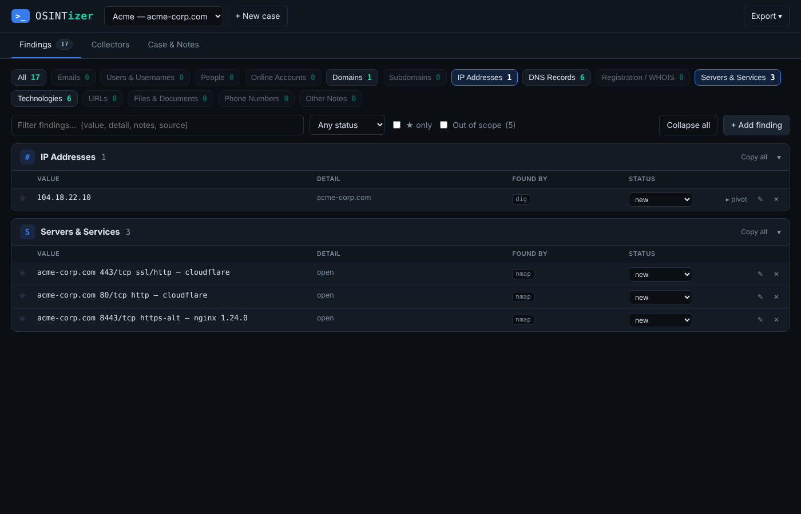

# OSINTizer

**Collect, auto-extract and organize OSINT recon findings — built for Kali Linux.**

OSINTizer launches the recon tools you already use on Kali (theHarvester, subfinder, amass, dig, whois, sherlock, holehe, whatweb, nmap), reads their output the moment they finish, and files everything it finds into one organized case — **grouped by type**: emails, users, people, online accounts, domains, subdomains, IPs, DNS records, WHOIS/registration data, open services, technologies, URLs, files and phone numbers.

No exporting a `.json` from one tab and importing it into another. Run a collector → findings appear.



---

## Network-safe by design

OSINTizer is built so recon doesn't knock over your home lab network (pfSense, OPNsense, consumer routers):

- **One collector at a time.** Runs go into a queue with a short pause between them, so traffic never comes in big parallel bursts.
- **Rate-limited defaults.** subfinder is capped at 10 requests/sec, theHarvester uses a small set of passive sources, Amass runs passive-only, and WhatWeb runs single-threaded.
- **Active collectors are opt-in.** Nmap and WhatWeb are disabled until you tick *Allow active collectors* (in the CLI, add `--active`). *Run all* only ever uses passive collectors.
- **Gentle Nmap.** It scans a single host only (no network ranges), with slow timing and a low packet rate.
- **Localhost only.** The dashboard binds to `127.0.0.1` unless you explicitly choose otherwise.

If you edit a collector's arguments to raise its speed, those limits no longer apply.

## Features

- **Automatic findings** — every collector run (and every paste) is parsed and merged into the case's findings as soon as it completes. A live counter shows `+N new` per run.
- **Filterable groups** — click a chip (Emails, IP Addresses, Servers & Services, Subdomains …) to show only those groups; pick several at once, or **All**. Findings are organized into:

  | Group | Examples |
  |---|---|
  | Emails | `jane.doe@acme.com` |
  | Users & Usernames | `jane.doe` (derived from emails), `jdoe_sec` (sherlock), social handles |
  | People | names from LinkedIn results, WHOIS registrants, page authors |
  | Online Accounts | GitHub/Reddit/X profiles, sites an email is registered on (holehe) |
  | Domains / Subdomains | root domains vs. discovered hosts, with resolved IPs |
  | IP Addresses | public/private flagged, CIDR ranges, which host they belong to |
  | DNS Records | MX, NS, TXT, SOA, CAA … |
  | Registration / WHOIS | registrar, registrant org, creation/expiry dates, ASNs |
  | Servers & Services | `host 443/tcp https — nginx 1.24` (from Nmap) |
  | Technologies | WordPress, jQuery, Cloudflare, **and providers inferred from DNS** (Google Workspace, Microsoft 365, SendGrid, Atlassian …) |
  | URLs / Files & Documents | interesting URLs; PDFs, spreadsheets, backups, configs |
  | Phone Numbers | |
- **Tool-aware parsing** — dedicated parsers for theHarvester, dig, dnsrecon, whois, sherlock/maigret, holehe, whatweb and nmap, plus a generic extractor for anything else.
- **Deduplication with provenance** — the same finding from three tools is one row showing all three sources and a hit count.
- **Scope control** — set in-scope domains per case; everything else is tagged *out of scope* and hidden by default.
- **Triage** — star key findings, mark `verified` / `interesting` / `false-positive`, add notes, copy a whole group in one click.
- **Pivot** — click `▸ pivot` on any email, username, domain or IP to make it the next collector target.
- **Paste or pipe anything** — ran a tool yourself? Paste its output in the UI, or pipe it: `sherlock jdoe | osintizer ingest --tool sherlock`.
- **Reports** — export Markdown (with a ★ Key Findings section and run log), CSV, or a full case backup to share with a teammate.
- **Zero dependencies** — pure Python 3 standard library. Works offline. Data lives in one SQLite file.

## Install (Kali)

```bash
git clone https://github.com/<your-username>/OSINTizer.git
cd OSINTizer
./install.sh --with-tools     # installs OSINTizer + the collectors it drives
```

Options:

| Command | What it does |
|---|---|
| `./install.sh` | Installs to `/opt/osintizer` and adds `osintizer` to your PATH |
| `./install.sh --user` | Installs just for you under `~/.local` (no sudo) |
| `./install.sh --with-tools` | Also `apt install`s theHarvester, whois, dnsutils, subfinder, amass, assetfinder, sherlock, whatweb, nmap, and `pipx install`s holehe + maigret |
| `pipx install .` | Alternative install as a Python package |
| `python3 -m osintizer` | Run straight from the cloned folder without installing |

Uninstall with `./uninstall.sh` (add `--purge` to also delete your case data).

## Quick start

```bash
osintizer            # opens the dashboard at http://127.0.0.1:8787
```

1. **Create a case** — name, primary target (e.g. `acme.com`) and in-scope domains.
2. **Collectors tab** — type a target. OSINTizer detects whether it's a domain, email, username, IP, CIDR or URL and highlights the collectors that accept it. Hit **Run all matching** or run them one by one.
3. **Findings tab** — results fill in automatically as each run finishes, grouped by type. Star, verify, annotate and pivot.
4. **Export** — Markdown report, CSV, or case backup.

### From the terminal

```bash
osintizer doctor                                   # which collectors are installed (+ install commands)
osintizer case new "Acme external" -t acme.com -s "acme.com,acme.io"
osintizer run theharvester acme.com -c "Acme external"
osintizer run sherlock jdoe_sec -v                 # -v streams tool output
osintizer run nmap scanme.nmap.org --active        # active collectors need --active
theHarvester -d acme.com -b all | osintizer ingest --tool theharvester
osintizer findings -g emails                       # print one group
osintizer export -f md -o acme_report.md
```

Commands default to your most recent case when `-c` is omitted.

## Collectors

| Collector | Input | Type | Kali install |
|---|---|---|---|
| theHarvester | domain | passive | `sudo apt install theharvester` |
| crt.sh | domain | passive | built in |
| subfinder | domain | passive | `sudo apt install subfinder` |
| Amass (passive) | domain | passive | `sudo apt install amass` |
| assetfinder | domain | passive | `sudo apt install assetfinder` |
| dig | domain | passive | `sudo apt install dnsutils` |
| whois | domain, IP | passive | `sudo apt install whois` |
| Sherlock | username | passive | `sudo apt install sherlock` |
| Maigret | username | passive | `pipx install maigret` |
| holehe | email | passive | `pipx install holehe` |
| WhatWeb | domain, URL | **active** | `sudo apt install whatweb` |
| Nmap (gentle, single host) | domain, IP | **active, opt-in** | `sudo apt install nmap` |

Each collector's arguments are editable in the UI (**Arguments**) or with `--args`, e.g. `--args "-d {target} -b all"`. Active collectors stay disabled until you turn on **Allow active collectors**.

**Adding a collector** is a few lines in `osintizer/collectors.py`; it immediately benefits from the generic extractor, and you can add a tool-aware parser in `osintizer/extractors.py`.

## Security notes

- The dashboard binds to `127.0.0.1` only. `--host 0.0.0.0` exposes it to your network — it prints a warning; don't do it on untrusted networks.
- The local API rejects foreign `Host` headers (DNS-rebinding protection) and requires a custom header on every write (CSRF protection).
- Tools run as argument lists, never through a shell, and targets are validated per input type, so a target can't inject commands or extra flags.
- Collected content is treated as untrusted and escaped everywhere in the UI; a strict Content-Security-Policy is applied.
- Data is stored at `~/.local/share/osintizer/osintizer.db` (override with `OSINTIZER_HOME` or `--db`).

## Legal

Only investigate targets you are authorized to assess. Active collectors (WhatWeb, Nmap) send traffic directly to the target. You are responsible for complying with applicable laws, scope agreements and the terms of service of the data sources you query.

## Development

```bash
python3 -m unittest discover tests     # extractor + storage tests
python3 -m osintizer --db /tmp/dev.db  # throwaway database
```

Project layout:

```
osintizer/
  cli.py          command line
  server.py       local web server + JSON API (stdlib only)
  runner.py       runs collectors in the background, files findings automatically
  collectors.py   collector registry (commands, input types, install hints)
  extractors.py   tool-aware parsers + generic extraction → grouped findings
  store.py        SQLite storage (cases, runs, findings, provenance)
  reports.py      Markdown / CSV / JSON export
  static/         dashboard UI (HTML/CSS/JS, no CDN)
tests/            unit tests with sample tool output
```

## License

MIT
